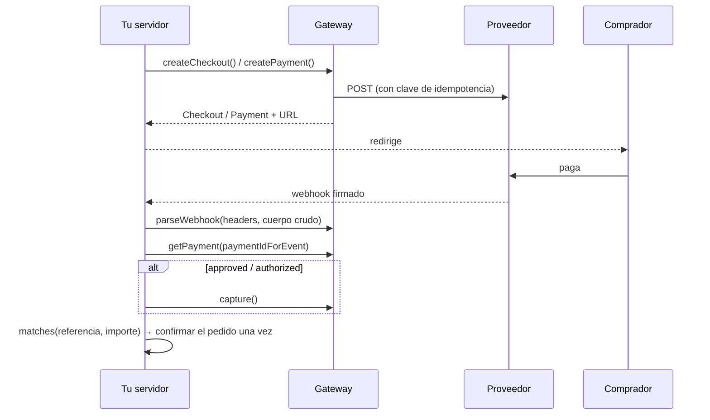

<div align="center">

# 💳 ronu/payment-gateways

**Un contrato de pagos para cualquier pasarela.**<br>
*One payment contract for any gateway.*

Mercado Pago · Stripe · PayPal — el mismo código, en el emulador y en producción.

[](https://github.com/charlietyn/payment-gateways/actions/workflows/ci.yml)


[](LICENSE)

[Instalar](#-instalar) · [Configurar](#%EF%B8%8F-configurar) · [Cobrar](#-tres-formas-de-cobrar) · [Webhooks](#-el-flujo-común) · [Nueva pasarela](#-añadir-otra-pasarela) · [Plan](docs/PLAN-2.md)

</div>

---

## ✨ Por qué

| | |
|---|---|
| 🔌 **Un contrato** | Tu código habla de `Payment`, `Money`, `Refund` y `WebhookEvent`, nunca de `preference`, `payment_intent` ni `purchase_units`. |
| 🧪 **Emulador → real sin tocar código** | Probado de punta a punta contra el **Payment Emulator Lab** (Plaza, Vector, Harbor). Para ir a producción cambias `environment` y las credenciales. |
| 🛒 **Página del proveedor o formulario propio** | Checkout Pro, Checkout Session y aprobación de PayPal, o los tokens de Brick y Elements. |
| 🔐 **Seguro por defecto** | Idempotencia en todas las escrituras, firmas de webhook verificadas sobre el cuerpo crudo, y si falta un secreto el webhook se rechaza. |
| 🧩 **Extensible** | Una pasarela nueva se registra con `GatewayFactory::extend()`, sin tocar la biblioteca. |
| 💰 **Dinero sin floats** | Importes en unidades menores con moneda ISO-4217; cada driver lo convierte al formato que pide su API. |

| Pasarela | Driver | Emulador | APIs |
|---|---|---|---|
|  Mercado Pago | `mercadopago` | Plaza | Orders · Checkout Pro · Payments |
|  Stripe | `stripe` | Vector | PaymentIntents · Refunds · Checkout Sessions |
|  PayPal | `paypal` | Harbor | OAuth · Orders v2 · Payments v2 |

## 📦 Instalar

```bash
composer require ronu/payment-gateways
```

PHP ≥ 8.2 con `ext-json` y `ext-openssl`. El núcleo no depende de ningún framework; el puente de Laravel se registra solo.

## ⚙️ Configurar

Todas las pasarelas usan **las mismas secciones**. Si falta o sobra algo, falla
al construir el gateway y el mensaje dice qué clave es (`credentials.secret_key is required`).

```php
use Ronu\PaymentGateways\GatewayFactory;

$gateway = GatewayFactory::make('tienda', [
    'driver'      => 'mercadopago',          // mercadopago | stripe | paypal | uno tuyo
    'environment' => 'emulator',             // emulator | sandbox | live

    'credentials' => ['access_token' => getenv('MERCADOPAGO_ACCESS_TOKEN')],
    'webhooks'    => ['secret' => getenv('MERCADOPAGO_WEBHOOK_SECRET')],
    'options'     => ['currency' => 'ARS'],

    'emulator'    => ['api_url' => 'http://localhost:8080', 'checkout_url' => 'http://localhost:3001'],
    'http'        => ['timeout' => 15, 'connect_timeout' => 5],
]);
```

<details>
<summary><b>Claves por pasarela</b></summary>

| Sección | Mercado Pago | Stripe | PayPal |
|---|---|---|---|
| `credentials` | `access_token` | `secret_key` | `client_id` + `client_secret` (o `access_token`) |
| `webhooks` | `secret`, `tolerance_seconds` (600) | `secret`, `tolerance_seconds` (300) | `id`, `cert_hosts`, `certificate`, `tolerance_seconds` (300) |
| `options` | `currency`, `ticket_method`, `notification_url`, `statement_descriptor` | `api_version` (fíjala) | `brand_name`, `locale`, `shipping_preference` |
| `emulator` | `api_url`, `checkout_url`, `scenario` | `api_url`, `scenario` | `api_url` |

Un `null` (un `env()` sin definir) se ignora y deja el valor por defecto.
`base_url` sustituye el host del entorno (proxies, mocks).

</details>

<details>
<summary><b>Presets: atajos con valores por defecto</b></summary>

```php
GatewayFactory::make('plaza', ['credentials' => […], 'emulator' => ['api_url' => …]]);
GatewayFactory::make('cobros', ['preset' => 'stripe', 'credentials' => […]]);  // cualquier nombre
```

| Driver | Emulador | Sandbox | Live |
|---|---|---|---|
| `mercadopago` | `plaza` | `mercadopago_sandbox` | `mercadopago` |
| `stripe` | `vector` | `stripe_test` | `stripe` |
| `paypal` | `harbor` | `paypal_sandbox` | `paypal` |

</details>

<details>
<summary><b>Laravel</b></summary>

```bash
php artisan vendor:publish --tag=payment-gateways-config
```

`config/payment-gateways.php` trae las tres pasarelas comentadas. Cada una elige
su entorno con `MERCADOPAGO_ENVIRONMENT`, `STRIPE_ENVIRONMENT` y `PAYPAL_ENVIRONMENT`.

```php
app(\Ronu\PaymentGateways\Contracts\Gateway::class);                                  // la de 'default'
app(\Ronu\PaymentGateways\Laravel\PaymentGatewaysManager::class)->gateway('paypal');  // una por nombre
```

</details>

## 🛒 Tres formas de cobrar

| | Mercado Pago | Stripe | PayPal |
|---|---|---|---|
| **A. Página del proveedor** · `createCheckout()` | Checkout Pro | Checkout Session | Aprobación de la orden |
| **B. Formulario incrustado** · `createPayment()` + `PaymentMethod` | Card Payment Brick | Elements (`pm_…`) o `clientSecret` | JS SDK con el id de la orden |
| **Ticket** · `createPayment()` sin método | Pago Fácil, Rapipago… | — | — |

### A · Página del proveedor (recomendado)

Tu servidor nunca ve la tarjeta y el frontend solo redirige.

```php
use Ronu\PaymentGateways\{CreatePayment, CheckoutStatus, Money, Payer};

$checkout = $gateway->createCheckout(new CreatePayment(
    amount: Money::fromDecimal('1500.50', 'ARS'),   // el importe lo decide tu servidor
    reference: 'ORDER-123',                         // tu id, único por checkout
    idempotencyKey: 'checkout-ORDER-123',
    description: 'Reserva',
    returnUrl: 'https://shop.example/pago/vuelta',  // obligatorio en Stripe y PayPal
    cancelUrl: 'https://shop.example/carrito',
    payer: Payer::fromFullName('Ana Pérez', 'ana@example.test', '30111222'),
));

return redirect($checkout->url);                    // guarda $checkout->id

// De vuelta en returnUrl, o al llegar el webhook:
$checkout = $gateway->getCheckout($checkoutId);
if ($checkout?->status === CheckoutStatus::Completed) {
    $payment = $gateway->getPayment($checkout->paymentId);
}
```

> Stripe: pon `{CHECKOUT_SESSION_ID}` en `returnUrl` para recibir el id de la sesión.
> Checkout Pro de Mercado Pago cobra en el momento (no admite captura manual).

### B · Formulario incrustado

```php
use Ronu\PaymentGateways\PaymentMethod;

// Mercado Pago: el token y el payment_method_id que devuelve el Brick
$gateway->createPayment(new CreatePayment(…, paymentMethod: PaymentMethod::card($token, 'visa', installments: 3)));

// Stripe: se confirma en el servidor con el PaymentMethod de Elements…
$gateway->createPayment(new CreatePayment(…, returnUrl: $url3ds, paymentMethod: PaymentMethod::card('pm_…')));
// …o se crea sin token y el navegador lo confirma con $payment->clientSecret
```

## 🔁 El flujo común



```php
$event   = $gateway->parseWebhook($request->headers(), $request->rawBody()); // InvalidWebhookSignature ⇒ 401
$payment = $gateway->getPayment($gateway->paymentIdForEvent($event));       // el evento solo avisa: se relee el pago

if ($payment->status->awaitsMerchant()) {           // PayPal aprobado o captura manual
    $payment = $gateway->capture($payment->id, idempotencyKey: "capture-{$payment->id}");
}
if ($payment->status === PaymentStatus::Captured && $payment->matches('ORDER-123', $importe)) {
    // confirmar el pedido, una sola vez
}

$gateway->refund($payment->id, Money::fromDecimal('500', 'ARS'), 'refund-ORDER-123-1'); // null = todo
```

<details>
<summary><b>Estados y errores</b></summary>

`created · requires_action · processing · approved · authorized · captured · partially_refunded · refunded · canceled · failed · disputed · unknown`

- `approved`: el comprador aprobó y **falta que cobres** (`capture()`), como en PayPal.
- `authorized`: captura manual pendiente (`capture()` o `cancel()`).
- `unknown`: un estado que la biblioteca no conoce. **No cumplas el pedido.**

`GatewayException::$retryable` es `true` ante fallos de red, 408, 429 y 5xx: reintenta
con la **misma** clave de idempotencia. `$providerCode` trae el código de error del proveedor.
Si reutilizas una clave con otro cuerpo, la respuesta es un 409 y no conviene reintentar.

</details>

## 🧭 Capacidades

```php
if ($gateway->supports(Capability::PartialCapture)) { … }
```

| | Mercado Pago | Stripe | PayPal |
|---|:-:|:-:|:-:|
| `HostedCheckout` | ✅ | ✅ | ✅ |
| `EmbeddedCheckout` | ✅ | ✅ | ✅ |
| `ManualCapture` | ✅ Orders | ✅ | ✅ |
| `PartialCapture` | — | ✅ | ✅ manual |
| `PartialRefund` | ✅ | ✅ | ✅ |
| `OfflinePayments` | ✅ | — | — |

<details>
<summary><b>Detalles por pasarela</b></summary>

| | Mercado Pago | Stripe | PayPal |
|---|---|---|---|
| Idempotencia | `X-Idempotency-Key` | `Idempotency-Key` | `PayPal-Request-Id` |
| Formato | JSON, importes decimales | **formulario**, unidades menores | JSON, importes decimales |
| Ids | `ORD…` (Orders), numérico (Payments) | `pi_…`, `cs_…` | id de la orden |
| Cobro | automático o `capture()` | automático o `capture()` | **siempre `capture()`** tras aprobar |
| Webhook | `x-signature`: HMAC de `id;request-id;ts` | `stripe-signature`: HMAC de `t.cuerpo` | RSA-SHA256 de `id\|time\|webhook_id\|crc32(cuerpo)` |

</details>

## 🧩 Añadir otra pasarela

Implementa `Contracts\Gateway` (y `Contracts\HostedCheckout` si el proveedor tiene
página propia), recibe un `Config\GatewayConfig` y regístrala:

```php
GatewayFactory::extend('adyen', fn (GatewayConfig $config, ?ClientInterface $http) => new AdyenGateway($config, $http));

GatewayFactory::make('eu', ['driver' => 'adyen', 'environment' => 'sandbox', 'credentials' => ['api_key' => '…']]);
```

`GatewayConfig` ofrece `credential()` (obligatoria y con mensaje claro), `option()`,
`webhook()`, `isEmulator()` y `resolveBaseUrl($hosts, $perfilDelEmulador)`.

## ⚠️ Límites conocidos

- **El emulador no tiene Checkout Pro ni Checkout Sessions.** Con `environment: emulator`,
  `createCheckout()` de Mercado Pago y Stripe usa las páginas propias de Plaza y Vector.
  Contra las APIs reales esos dos caminos solo están probados con respuestas simuladas
  según la documentación; **aún no contra el sandbox** ([M10](docs/PLAN-2.md)).
- **Checkout Pro**: `getCheckout()` busca el pago por `external_reference`, así que la referencia debe ser única por checkout.
- **Stripe**: un PaymentIntent no refleja las devoluciones, así que `getPayment()` sigue en `captured`. Usa el `Refund` que devuelve `refund()`.
- **PayPal**: el certificado de firma solo se descarga de los hosts de `webhooks.cert_hosts`.

## 🧪 Tests

```bash
composer test        # unitarios, Guzzle simulado
composer analyse     # PHPStan nivel 8

# Contra un Payment Emulator Lab (crea sus propias aplicaciones)
PAYMENT_EMULATOR_URL=http://localhost:8080 \
PAYMENT_EMULATOR_ADMIN_TOKEN=… \
PAYMENT_EMULATOR_SINK_PORT=8095 composer test:integration
```

---

<div align="center">
<sub>MIT · Desarrollado por <b>RonuSoftware</b> · No está afiliado a Mercado Pago, Stripe ni PayPal; sus nombres solo identifican las APIs compatibles.</sub>
</div>
